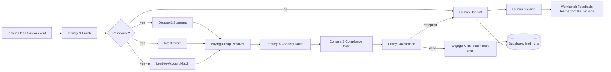

# Inbound Revenue Capture Agent

An AI sales-intake employee built as an **orchestrator plus 12 operators**. A website visitor or inbound lead comes in; the agent identifies and enriches them, removes duplicates, scores intent, matches them to an account, routes them to the right rep, checks consent, and either engages or hands the lead to a human with full context.

Built on the Supervity Auto agent platform with Supabase, HubSpot, Slack and Outlook. I designed and built the agent side; a web dashboard on top (policies, human queue, insights) was built by my co-founder.

## Architecture

## The 12 operators

| Operator | Job |
|---|---|
| Identify & Enrich | Resolve the lead, log the event, create or update the CRM contact and company |
| Dedupe & Suppress | Catch near-duplicates across sources, with a confidence ordering and a 7-day window |
| Intent Score | Score from events and ICP signals into Hot / Warm / Cold |
| Lead-to-Account Match | Match to an account with a confidence score; escalate ambiguous matches with all candidates |
| Buying-Group Resolver | Group several contacts at one account into one buying group |
| Territory & Capacity Router | Apply routing rules, detect rule collisions, over-capacity reps and unowned territories |
| Consent & Compliance Gate | Block outreach on missing or conflicting regional consent; strictest record wins |
| Policy Governance | Evaluate business-editable policies before the agent acts and log every evaluation |
| Human Handoff | Write an exception to the human queue with re-derived context, then alert in Slack |
| Engage | Choose the sequence, create a deal only for Hot leads, write one draft email per buying group |
| Insight Generator | Turn run data into findings (routing collisions, reps at capacity, consent clusters, forming buying groups) |
| Workbench Feedback | Learn from human decisions so the same ambiguity resolves cleanly next time |

## Design decisions that mattered

- **A shared state table instead of passing results between workflows.** The platform does not expose a sub-workflow's return values to its parent, so all state lives in one Supabase table (`lead_runs`) keyed by session id.
- **Every operator takes only a session id.** Each one re-reads the row itself and writes a disjoint set of columns. Parallel branches cannot overwrite each other, and the merge-step bugs go away by construction.
- **Consent gates outreach regardless of score.** A Hot lead with conflicting consent still goes to a human.
- **Draft-only email.** The agent writes drafts; it never sends on its own.
- **Humans stay in the loop.** Ambiguous or risky cases go to a queue with the evidence needed to decide in one click.

## What broke, and how I fixed it

| Problem | Cause | Fix |
|---|---|---|
| A run reported "success" while every database call had failed | Generated code swallowed exceptions | Made write failures raise; verified by querying the database, not by the run summary |
| Results computed correctly but never saved | A PATCH sent `"updated_at": "now()"` as a literal string, so the API rejected the whole request and every other field stayed null | Send a real timestamp, and treat a zero-row write as an error |
| Operator processed the wrong lead | Generated code contained a hardcoded override for one test session id | Removed it, then audited every operator for the same pattern |
| Intent scores were all zero | Scoring read a field that nothing ever populated; the real source was a different table | Pointed it at the real event table and re-verified against known leads |

## How I tested

- Seeded one test lead per trap (duplicates, a collision, an over-capacity rep, a consent conflict, an ambiguous account).
- Scoped test resets by operator prefix so one operator's evidence is never wiped by another's.
- Verified every result by querying the database directly, never by trusting the run's own "Completed" message.
- Proved the learning loop end to end: after a human chose an account, the same ambiguous lead resolved cleanly with no escalation.

## Stack

| Layer | Tools |
|---|---|
| Agent platform | Supervity Auto (orchestrator plus 12 operators) |
| State and data | Supabase / PostgreSQL (the `lead_runs` table) |
| CRM | HubSpot (contacts, companies, deals) |
| Alerts | Slack (human-handoff notifications) |
| Email | Outlook (draft-only outreach) |
| Scripting | Python |
